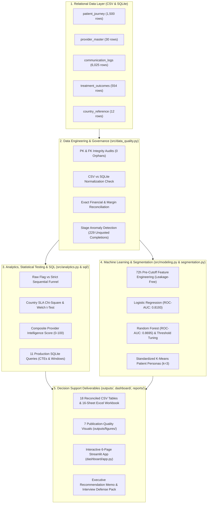
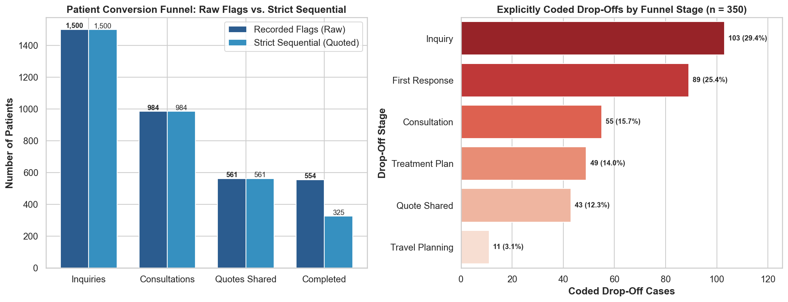
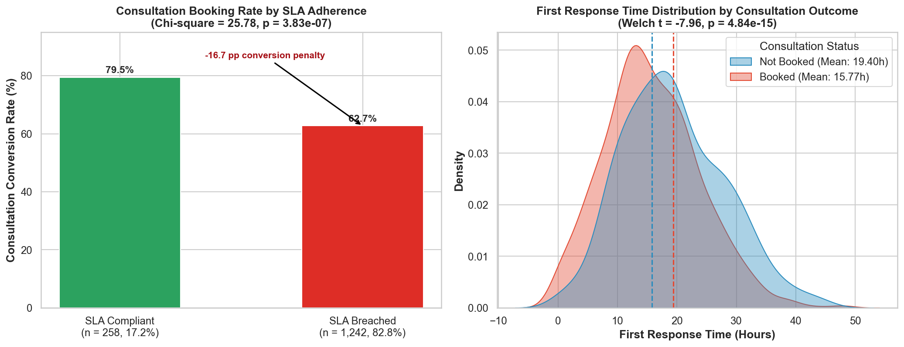
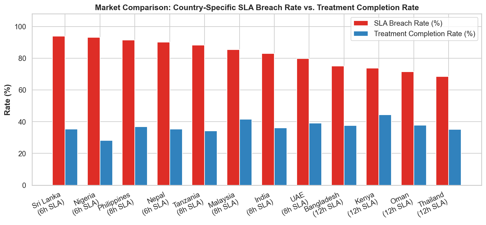
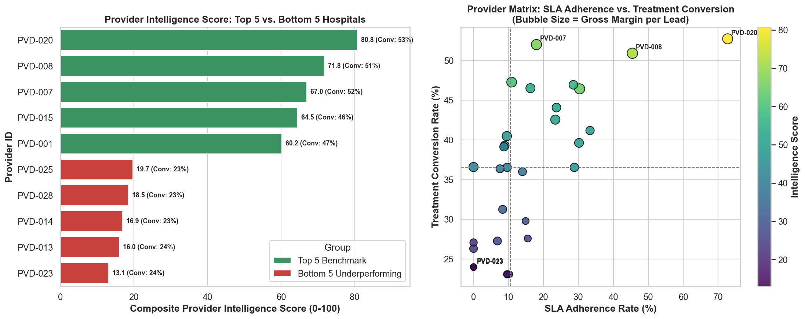
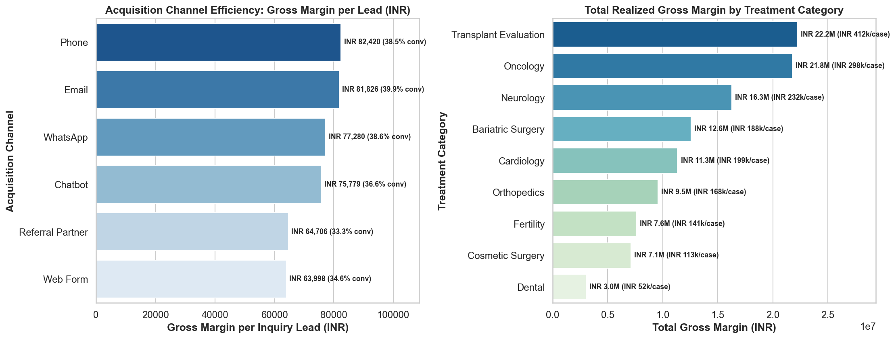
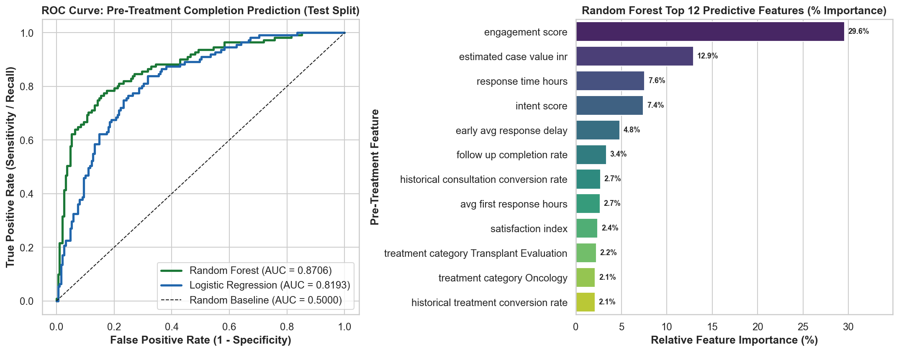
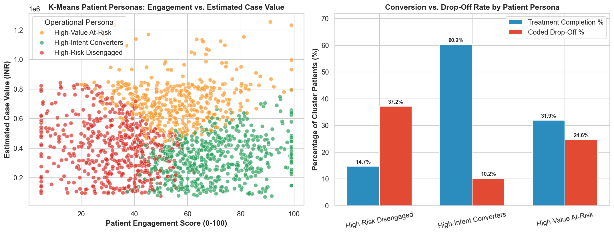

# 🏥 MedTourEasy Patient Conversion & Provider Performance Intelligence

[](https://www.python.org/)
[](https://www.sqlite.org/)
[](https://scikit-learn.org/)
[](https://streamlit.io/)
[](tests/test_pipeline.py)

An end-to-end **Healthcare Operations Data Science, SQL Analytics & Machine Learning** system analyzing **1,500 international patient journeys**, **6,025 communication touchpoints**, **30 partner hospitals**, **15 care coordinators**, and **12 source countries**.

Built to answer executive decisions on **funnel drop-off leakage**, **country-specific SLA adherence**, **partner hospital benchmarking**, **pre-treatment completion risk scoring**, **patient persona segmentation**, and **gross-margin recovery scenarios**.

---

## 📌 1. Business Problem

MedTourEasy facilitates cross-border medical travel across high-acuity and elective procedures (*Transplant Evaluation, Oncology, Neurology, Cardiology, Orthopedics, Bariatric Surgery, Fertility, Cosmetic Surgery, and Dental*). Operations leadership faced four core challenges:

1. **Funnel Attrition & Unreconciled Stage Tracking:** While **65.6%** of incoming patients booked a consultation, only **36.9% (554 patients)** completed treatment—leaving **₹166.51M in estimated case value exposure** across **350 explicitly coded drop-offs**.
2. **Severe First-Response SLA Breaches:** International patients across 12 source markets expect rapid turnaround (`6h`, `8h`, or `12h` country SLA baselines), but lacked automated SLA monitoring linked to conversion outcomes.
3. **One-Dimensional Hospital Rankings:** Partner hospitals were evaluated on raw conversion counts rather than a balanced composite of conversion efficiency, SLA adherence, follow-up completion, patient satisfaction, and gross margin per lead.
4. **Delayed Intervention on High-Value Leads:** Care coordinators needed a leakage-free, pre-treatment ML risk score and persona framework within the **first 72 hours of inquiry** to prioritize at-risk patients before they disengaged.

---

## 🏗️ 2. System Architecture



---

## 📂 3. Dataset Overview & Schema Reconciliation

All five relational tables reconcile 100% on row counts and primary/foreign keys between the raw CSV pack and `mte_patient_intelligence.db`:

| Table Name | Rows | Columns | Primary Key | Key Relationships & Audit Findings |
|---|---:|---:|---|---|
| `patient_journey` | **1,500** | 26 | `patient_id` | 0 nulls, 0 duplicates; links to `provider_id` and `country`. `satisfaction_score` is structurally missing for all 946 non-completed cases. |
| `provider_master` | **30** | 14 | `provider_id` | 30 partner hospitals across 5 regions, 9 specialties, and 3 pricing tiers (`Economy`, `Standard`, `Premium`). |
| `communication_logs` | **6,025** | 10 | `communication_id` | Links to `patient_id` and `provider_id`. `1,413` rows have null `response_delay_hours`, 100% corresponding to `response_sent = 0`. |
| `treatment_outcomes` | **554** | 10 | `patient_id` | Exact 1:1 match with the 554 `treatment_completed = 1` records in `patient_journey`. Revenue (`₹248.33M`) and margin (`₹111.51M`) reconcile to the exact rupee. |
| `country_reference` | **12** | 7 | `country` | Defines `baseline_response_expectation_hours` (`6h`, `8h`, `12h`), medical visa rules, and `market_priority_score`. |

---

## 🛠️ 4. Tech Stack

- **Data Engineering & Analytics:** `Python 3.9+`, `pandas`, `NumPy`, `SQLite3`, `openpyxl`
- **Statistical Inference:** `SciPy` (`chi2_contingency`, `ttest_ind`), `statsmodels`
- **Machine Learning & Clustering:** `scikit-learn` (`Pipeline`, `ColumnTransformer`, `LogisticRegression`, `RandomForestClassifier`, `KMeans`, `StandardScaler`, `OneHotEncoder`, `SimpleImputer`)
- **Visualization & BI:** `Matplotlib`, `Seaborn`, `Plotly`, `Streamlit`
- **Testing & Reproducibility:** `pytest` (11 automated test suites covering all pipeline stages), `nbformat`

---

## 📊 5. Key Audited Findings & Visual Analytics

### Executive KPI Summary

| Metric / KPI | Audited Result | Context / Methodological Note |
|---|---:|---|
| **Total Patient Inquiries** | **1,500** | Base population across 12 countries & 9 specialties |
| **Consultations Booked** | **984 (65.60%)** | 516 inquiries fail to book a consultation |
| **Quotes Shared** | **561 (57.01% of consultations)** | 423 booked consultations do not receive a recorded quote |
| **Recorded Treatment Completions** | **554 (36.93% of inquiries)** | Exact match with `treatment_outcomes` (554 rows) |
| **Completed Patients Missing `quote_shared=1`** | **229** | Critical stage-tracking anomaly uncovered during audit |
| **Strict Sequential Completions (`quote_shared=1`)** | **325 (57.93% of quotes)** | True sequential quote-to-treatment conversion (vs 98.75% raw artifact) |
| **Explicitly Coded Drop-Offs (`drop_off_flag=1`)** | **350 (23.33% of inquiries)** | Concentrated in Inquiry (103) and First Response (89) stages |
| **Country SLA Breach Rate** | **82.80% (1,242 / 1,500)** | `response_time_hours > baseline_response_expectation_hours` |
| **Consultation Rate: No SLA Breach vs. SLA Breach** | **79.46% vs. 62.72%** | **-16.74 pp gap** ($\chi^2 = 25.78, p = 3.83 \times 10^{-7}$, Cramér's $V = 0.131$) |
| **Mean First Response Time: Booked vs. Not Booked** | **15.77h vs. 19.40h** | **-3.63h difference** (Welch $t = -7.96, p = 4.84 \times 10^{-15}$, Cohen's $d = -0.431$) |
| **Logistic Regression Test ROC-AUC** | **0.8193** | Precision `0.6187`, Recall `0.7748`, F1 `0.6880` |
| **Random Forest Test ROC-AUC** | **0.8695** | Precision `0.7723`, Recall `0.7027`, F1 `0.7358` (at 0.40 threshold: Recall `0.7838`) |
| **Observed Gross Revenue** | **₹248,325,245 (₹248.33M)** | Realized across 554 completed treatments |
| **Observed Gross Margin** | **₹111,514,356 (₹111.51M)** | **44.91%** realized margin rate (`₹201,289` margin per completed case) |
| **Drop-Off Case Value Exposure** | **₹166,511,306 (₹166.51M)** | Top 20% of drop-offs account for `₹54.40M`; **10% recovery scenario = ₹7.48M margin** |

---

### 5.1 Patient Funnel & The "229 Unquoted Completions" Discovery


- **Governance Insight:** Dividing recorded completions (`554`) by recorded quotes (`561`) yields a misleading **98.75%** conversion ratio because **229 completed patients have `quote_shared = 0`**. Filtering to strict sequential progression (`325 / 561`) reveals the true **57.93%** quote-to-treatment conversion rate.
- **Drop-Off Concentration:** Out of 350 explicitly coded drop-offs, **54.86% (`192` cases)** occur at the **Inquiry (`103`)** and **First Response (`89`)** stages. Leading reasons are **No follow-up (`66`)**, **Cost concern (`62`)**, and **Response delay (`60`)**.

---

### 5.2 Statistical Hypothesis Testing: Country SLA Breach vs. Consultation Booking



- **Chi-Square Independence Test:** Patients receiving a response within their country's SLA baseline booked consultations at **79.46% (`205/258`)**, compared to **62.72% (`779/1,242`)** when SLA was breached ($\chi^2 = 25.78, p = 3.83 \times 10^{-7}$).
- **Welch's Two-Sample $t$-Test:** Consultation-booked patients experienced a significantly lower mean response time (**15.77h vs. 19.40h**, $t = -7.96, p = 4.84 \times 10^{-15}$).
- **Market Vulnerability:** 6-hour SLA markets suffer the worst breach rates—**Sri Lanka (94.0%)**, **Nigeria (93.2%, lowest completion at 28.2%)**, and **Nepal (90.2%)**.

---

### 5.3 Provider & Channel Intelligence



- **Composite Provider Intelligence Score (`0–100`):** Combines **30% Conversion**, **20% SLA Adherence**, **15% Follow-up Completion**, **15% Satisfaction**, and **20% Margin per Lead**.
  - **Top 3 Benchmarks:** `PVD-020` (**80.78** score, `52.7%` conversion, `5.85h` response, `72.7%` SLA adherence), `PVD-008` (**71.77** score, `₹111,739` margin/lead), and `PVD-007` (**67.00** score, `52.0%` conversion but `18.0%` SLA adherence—flagged for intake workflow repair).
  - **Bottom 3 Underperformers:** `PVD-023` (**13.06**), `PVD-013` (**16.02**), and `PVD-014` (**16.89**)—all converting `<24%` with `0%–9.6%` SLA adherence.
- **Channel & Specialty Economics:**
  - **Channels:** **Phone** generates the highest gross margin per lead (**₹82,420**), **Email** achieves the highest completion rate (**39.92%**) and lowest drop-off (**18.91%**), while **Web Form** suffers the highest drop-off rate (**27.24%**).
  - **Specialties:** **Transplant Evaluation** (**₹22.24M** margin, **₹411.9k/case**), **Oncology** (**₹21.77M** margin, **₹298.3k/case**), and **Neurology** (**₹16.26M** margin, **₹232.2k/case**) generate **54.0%** of total company gross margin.

---

## 🤖 6. Machine Learning: Pre-Treatment Completion Prediction



### Strict Data Leakage Prevention
To ensure the model is valid for real-time triage at **hour 72 post-inquiry**, our pipeline (`src/modeling.py`) enforces hard guardrails:
- **Excluded Post-Treatment Outcomes:** `actual_revenue_inr`, `service_cost_inr`, `gross_margin_inr`, `satisfaction_score` (only recorded for completed treatments), and all `treatment_outcomes` fields.
- **Excluded Downstream Funnel Flags:** `consultation_booked`, `quote_shared`, `follow_up_completed`, `current_stage`, `drop_off_flag`, `drop_off_stage`, `reason_for_drop_off`.
- **72-Hour Communication Cutoff:** Only `communication_logs` occurring within $0 \le t - t_{\text{inquiry}} \le 72\text{h}$ are aggregated into `early_interactions`, `early_response_rate`, `early_avg_response_delay`, and `early_followup_completed`.

### Model Evaluation (80/20 Stratified Split, $N_{\text{train}}=1,200, N_{\text{test}}=300$)

| Model | Threshold | ROC-AUC | Precision | Recall | F1-Score | TN | FP | FN | TP |
|---|---:|---:|---:|---:|---:|---:|---:|---:|---:|
| **Logistic Regression (`class_weight="balanced"`)** | 0.50 | **0.8193** | 0.6187 | 0.7748 | 0.6880 | 136 | 53 | 25 | 86 |
| **Random Forest (`class_weight="balanced"`)** | 0.50 | **0.8695** | **0.7723** | 0.7027 | **0.7358** | 166 | 23 | 33 | 78 |
| **Random Forest (High-Recall Triage Mode)** | **0.40** | **0.8695** | 0.6797 | **0.7838** | 0.7280 | 148 | 41 | 24 | 87 |
| **Random Forest (Aggressive Screening Mode)** | 0.30 | **0.8695** | 0.6164 | **0.8829** | 0.7259 | 128 | 61 | 13 | 98 |

---

## 👥 7. Patient Personas (K-Means Clustering)



Standardized K-Means clustering ($k=3$, `random_state=42`) across `intent_score`, `response_time_hours`, `engagement_score`, and `estimated_case_value_inr` segments the 1,500 patients into three operational personas:

| Persona | Patients | Avg Intent | Avg Response | Avg Engagement | Avg Case Value | Consult Rate | Completion Rate | Drop-Off Rate | Realized Gross Margin | Recommended Action |
|---|---:|---:|---:|---:|---:|---:|---:|---:|---:|---|
| **High-Intent Converters** | **571** (38.1%) | **75.3** | **15.0h** | **69.7** | ₹327,005 | **82.0%** | **60.2%** | **10.2%** | **₹52.20M** | Protect SLA, fast-track quote turnaround, automate travel/visa checklists |
| **High-Value At-Risk** | **426** (28.4%) | 63.1 | 16.4h | 55.5 | **₹716,827** | 67.8% | **31.9%** | **24.6%** | **₹46.58M** | **#1 Priority:** Senior coordinator escalation, match to top-5 hospitals (`PVD-020`, `PVD-008`), itemized financial counseling |
| **High-Risk Disengaged** | **503** (33.5%) | 45.6 | **19.8h** | 32.1 | ₹402,100 | 45.1% | **14.7%** | **37.2%** | ₹12.74M | Automated <1h WhatsApp/Chatbot re-contact & language/cost qualification |

---

## 📁 8. Repository Structure

```text
medtoureasy-patient-intelligence/
├── README.md                                          # Comprehensive project documentation
├── requirements.txt                                   # Reproducible Python dependencies
├── .gitignore                                         # Excludes raw patient CSV/SQLite files from public repo
├── GITHUB_UPLOAD_CHECKLIST.md                         # Pre-commit verification checklist
├── data/
│   └── README.md                                      # Instructions for placing local CSV & SQLite files
├── docs/
│   ├── PROJECT_SCOPE.md                               # Six-week PRD scope mapping
│   └── ASSUMPTIONS_LOG.md                             # Documented analytical & modeling assumptions
├── src/
│   ├── __init__.py                                    # Package exports
│   ├── data_quality.py                                # Loaders, PK/FK audits, CSV-SQLite & financial reconciliation
│   ├── analytics.py                                   # Funnel, SLA statistical tests, provider/channel scorecards
│   ├── modeling.py                                    # 72h feature engineering, leakage guardrails, LR & RF pipelines
│   ├── segmentation.py                                # Standardized K-Means clustering & persona profiling
│   └── eda.py                                         # Publication-quality visualization generator
├── scripts/
│   ├── run_pipeline.py                                # End-to-end master execution script
│   └── build_notebooks.py                             # Programmatic notebook execution & output builder
├── sql/
│   └── medtoureasy_analysis.sql                       # 11 interview-grade SQLite queries (CTEs, joins, windows)
├── dashboard/
│   └── app.py                                         # Interactive 6-page Streamlit intelligence dashboard
├── notebooks/
│   ├── 01_data_quality_report.ipynb                   # Executed notebook: schema, keys, missingness & financials
│   ├── 02_exploratory_patient_funnel_analysis.ipynb   # Executed notebook: funnel, drop-offs & SLA hypothesis tests
│   ├── 03_sql_provider_scorecard.ipynb                # Executed notebook: SQL layer & provider/channel scorecards
│   ├── 04_modeling_dropoff_and_completion.ipynb       # Executed notebook: leakage-free ML & threshold tuning
│   └── 05_segmentation_and_recommendations.ipynb      # Executed notebook: K-Means personas & recovery scenarios
├── outputs/
│   ├── figures/                                       # 7 high-resolution PNG charts embedded in reports/README
│   ├── executive_dashboard.xlsx                       # 16-sheet management workbook
│   └── *.csv                                          # 18 reconciled analytical, ML, and governance CSV outputs
├── reports/
│   ├── data_quality_summary.md                        # Data governance & reconciliation audit report
│   └── executive_recommendation_memo.md               # Management-ready 10-section executive memo
├── interview_prep/
│   ├── 01_project_walkthrough_and_pitches.md          # 2-min pitch, 5-min technical walkthrough & architecture
│   ├── 02_technical_defense_guide.md                  # Deep-dive defense: leakage, stats, ML, K-Means & financials
│   └── 03_50_interview_questions_and_answers.md       # 50 project-specific interview Q&As + follow-up traps
└── tests/
    └── test_pipeline.py                               # 11 automated pytest tests across all 9 analytical domains
```

---

## 🚀 9. Setup & Execution Instructions

### 1. Clone Repository & Set Up Environment
```bash
git clone https://github.com/Integenpiyush/medtoureasy-patient-intelligence.git
cd medtoureasy-patient-intelligence

python3 -m venv .venv
source .venv/bin/activate
pip install -r requirements.txt
```

### 2. Place Local Source Data in `data/`
Ensure the six supplied source files (`patient_journey.csv`, `provider_master.csv`, `communication_logs.csv`, `treatment_outcomes.csv`, `country_reference.csv`, `mte_patient_intelligence.db`) are located in `data/`. *(Excluded from git version control by `.gitignore` for data privacy).*

### 3. Run the End-to-End Pipeline
```bash
python scripts/run_pipeline.py
```
This validates all tables, reconciles financials, runs statistical tests, trains the Logistic Regression and Random Forest models, fits K-Means personas, generates all 18 CSV tables in `outputs/`, saves 7 PNG charts in `outputs/figures/`, and builds `outputs/executive_dashboard.xlsx`.

### 4. Run Automated Test Suite
```bash
pytest tests/ -v
```

### 5. Launch the Interactive Streamlit Dashboard
```bash
streamlit run dashboard/app.py
```

---

## ⚠️ 10. Limitations & Future Improvements

- **Observational SLA Data:** The 16.74 pp consultation conversion gap between SLA-compliant and SLA-breached inquiries demonstrates strong statistical association ($\chi^2 = 25.78$), not causality. **Next Step:** Run a randomized controlled A/B experiment routing 50% of `Web Form` and `Referral Partner` leads to an automated `<2h` rapid-triage pod.
- **Quote-Stage Logging Defect:** `229` completed patients lack `quote_shared = 1`. **Next Step:** Enforce a hard CRM validation rule requiring a quote record before marking any case `Treatment Completed`, and backfill historical hospital quote timestamps.
- **Survival / Time-to-Event Modeling:** Currently, completion risk is scored as a binary outcome at hour 72. **Next Step:** Implement Cox Proportional Hazards / survival analysis to model continuous time-to-dropoff across the multi-week travel preparation window.
